# Full-Stack Multimodal RAG System 🚀

[](https://www.python.org/)
[](https://fastapi.tiangolo.com/)
[](https://nextjs.org/)
[](https://www.langchain.com/)
[](https://groq.com/)
[](https://www.trychroma.com/)
[](LICENSE)

An enterprise-ready, end-to-end **Multimodal Retrieval-Augmented Generation (RAG)** system designed to ingest, index, and query complex unstructured documents (PDFs containing raw text, structured tables, and embedded images). 

Built with a modern full-stack decoupled architecture: **Next.js/React frontend**, **FastAPI asynchronous backend**, **Unstructured hi-res vision partitioning**, **HuggingFace dense embeddings**, **ChromaDB vector store**, and high-speed **Llama-4 / Llama-3.x inference on Groq**.

---

## 🌟 Key Features

- **📑 High-Resolution Multimodal Parsing**: Extracts textual content, reconstructs HTML table structures, and isolates embedded graphics/images from dense PDF documents using `unstructured`.
- **👁️ AI-Powered Multimodal Summarization**: Enriches visual chunks and tabular structures with rich, searchable semantic descriptions generated by Vision LLMs via Groq before embedding.
- **🔄 Conversational Context & Query Rewriting**: Condenses chat history and reformulates ambiguous multi-turn follow-up prompts into standalone, search-optimized queries.
- **🎯 Maximal Marginal Relevance (MMR) Retrieval**: Balances query relevance and semantic diversity (`k=3`, `fetch_k=10`, `lambda_mult=0.5`) across cosine similarity vector space.
- **⚡ Ultra-Low Latency Inference**: Leverages Groq's LPU acceleration for lightning-fast token generation and real-time streaming output.
- **🌐 Full-Stack Architecture**: Modern web client for drag-and-drop document uploads, citation tracking, and streaming interactive chat.

---

## 🏗️ System Architecture

```mermaid
flowchart TD
    subgraph Client["Frontend Layer (Next.js / React)"]
        UI["Modern Chat & Upload UI"]
        Stream["SSE / WebSocket Token Stream"]
    end

    subgraph API["Backend Services (FastAPI)"]
        Router["API Gateway / Routers"]
        Auth["Auth & Session Controller"]
        Queue["Async Worker Queue (Celery / Background Tasks)"]
    end

    subgraph Ingestion["Multimodal Ingestion Pipeline"]
        PDF["PDF Uploads"] --> Part["Unstructured hi_res Partitioning"]
        Part --> Chunk["chunk_by_title (Semantic Chunking)"]
        Chunk --> Classify{"Content Type Classifier"}
        Classify -->|Text| RawText["Raw Text"]
        Classify -->|Tables| HTMLTable["HTML / Markdown Tables"]
        Classify -->|Images| ImgExtract["Base64 Image Payloads"]
        RawText & HTMLTable & ImgExtract --> VisionLLM["Groq Vision / Llama Summarizer"]
        VisionLLM --> Embedder["HuggingFace Embeddings (all-MiniLM-L6-v2)"]
    end

    subgraph Storage["Data & Vector Layer"]
        Embedder --> VectorDB[("ChromaDB Vector Store")]
        S3[("Object Storage / Local Blobs")]
    end

    subgraph RetrievalEngine["Retrieval & Generation Engine"]
        UserQuery["User Input Query"] --> ReWriter["Query Rewriter (Chat History Aware)"]
        ReWriter --> Search["MMR Diversity Vector Search"]
        VectorDB --> Search
        Search --> Context["Augmented Document Context"]
        Context --> Llama["Groq ChatGroq LLM Engine"]
        Llama --> Stream
    end

    UI --> Router
    Router --> Queue
    Queue --> Ingestion
    ImgExtract -.-> S3
    Router --> UserQuery
    Stream --> UI
```



---

## 💻 Full-Stack Implementation Overview

This project is architected for a complete full-stack deployment:

### 1. Frontend (Next.js / React + Tailwind CSS)
* **Interactive Chat Console**: Real-time markdown rendering with code syntax highlighting and collapsible context inspection.
* **Document Management Center**: Drag-and-drop PDF ingestion with live upload progress, chunk status, and parsing previews.
* **Inspectable Grounding & Citations**: Direct source attribution showing the exact text chunks, extracted tables, and rendered image figures used to formulate each answer.

### 2. Backend (FastAPI + Asynchronous Worker)
* **REST & Streaming Endpoints**: Full CRUD for document collections, conversational session memory, and Server-Sent Events (SSE) for low TTFT (Time-To-First-Token).
* **Decoupled Heavy Ingestion**: Dedicated background workers for compute-intensive OCR, document parsing, and vector indexing without blocking user requests.
* **Session Memory Store**: Stateful multi-turn chat management with Redis or PostgreSQL persistence.

### 3. AI / RAG Pipeline (LangChain + ChromaDB + Groq)
* **Multi-Representation Indexing**: Embeds rich AI-generated summaries while mapping back to original raw text, table structures, and image visual assets.
* **Query Transformation**: Dynamic multi-query expansion and contextual re-writing for high-precision retrieval.

---

## 🛠️ Tech Stack

| Domain | Technologies |
| :--- | :--- |
| **Frontend** | React, Next.js, Tailwind CSS, Lucide Icons, TypeScript |
| **Backend & API** | FastAPI, Pydantic, Uvicorn, Python 3.10+ |
| **RAG Orchestration**| LangChain, LangChain Core, LangChain Community |
| **Document Processing**| Unstructured (`hi_res`), PDFMiner, Tesseract OCR, Poppler |
| **Vector Store** | ChromaDB (`hnsw:space: cosine`) |
| **Embeddings** | HuggingFace (`sentence-transformers/all-MiniLM-L6-v2`) |
| **LLM Inference** | Groq Cloud (`meta-llama/llama-4-scout-17b-16e-instruct` / `llama-3.3-70b-versatile`) |

---

## 📂 Project Structure

```text
RAG-system/
├── app/                        # Production Backend Application
│   ├── api/                    # FastAPI routes & endpoints (chat, upload, health)
│   ├── core/                   # Configuration, settings, and logging
│   ├── services/
│   │   ├── ingestion.py        # PDF partitioning, table extraction, and image analysis
│   │   ├── retrieval.py        # MMR search, hybrid retrieval, and query reformulation
│   │   └── generator.py        # Prompt composition and Groq LLM streaming
│   ├── schemas/                # Pydantic request and response models
│   └── main.py                 # FastAPI application entry point
├── frontend/                   # Modern React / Next.js client
│   ├── components/             # Chat UI, document uploader, source citations
│   ├── hooks/                  # Streaming and session state hooks
│   └── pages/ / app/           # Next.js app router and layout
├── notebooks/                  # Prototyping & research experiments
│   ├── Ingestion_Pipeline.ipynb     # Multimodal PDF extraction & vector storage
│   ├── Retrieval_Pipeline.ipynb     # MMR retrieval & conversational query loop
│   └── Multi_query_retrieval.ipynb  # Multi-query expansion experiments
├── db/                         # Persisted ChromaDB vector storage
├── docs/                       # Architectural diagrams & specifications
├── .env.example                # Sample environment variable declarations
├── .gitignore                  # Git untracked files specification
├── requirements.txt            # Python dependencies
└── README.md                   # Project documentation
```

---

## 🚀 Quickstart Guide

### Prerequisites
- Python 3.10 or higher
- Node.js 18+ (for frontend)
- [Poppler](https://poppler.freedesktop.org/) & [Tesseract OCR](https://github.com/tesseract-ocr/tesseract) installed on your operating system (required for PDF high-res parsing)
- A valid [Groq API Key](https://console.groq.com/)

---

### 1. Clone the Repository & Configure Environment

```bash
git clone https://github.com/<your-username>/RAG-system.git
cd RAG-system
```

Create a `.env` file from the provided template:

```bash
cp .env.example .env
```

Add your credentials inside `.env`:
```env
GROQ_API_KEY=gsk_your_groq_api_key_here
CHROMA_PERSIST_DIR=db/chroma_db
EMBEDDING_MODEL_NAME=all-MiniLM-L6-v2
LLM_MODEL_NAME=meta-llama/llama-4-scout-17b-16e-instruct
```

---

### 2. Backend Setup

Set up a virtual environment and install the required dependencies:

```bash
# Create and activate virtual environment
python -m venv .venv

# Windows:
.venv\Scripts\activate
# Linux/macOS:
source .venv/bin/activate

# Install dependencies
pip install -r requirements.txt
```

Run the backend development server:

```bash
uvicorn app.main:app --reload --host 0.0.0.0 --port 8000
```
Interactive Swagger documentation will be available at `http://localhost:8000/docs`.

---

### 3. Frontend Setup

Navigate to the frontend directory and install dependencies:

```bash
cd frontend
npm install
npm run dev
```

The web console will be accessible at `http://localhost:3000`.

---

### 4. Running the Prototyping Notebooks

If you prefer exploring the raw pipeline scripts interactively:
1. Launch Jupyter Lab:
   ```bash
   jupyter lab
   ```
2. Run `Ingestion_Pipeline.ipynb` to process a document and create your vector index.
3. Open `Retrieval_Pipeline.ipynb` to execute the terminal conversational agent.

---

## 🗺️ Roadmap & Production Enhancements

- [x] High-resolution multimodal PDF parsing (text, tables, images)
- [x] AI-enriched summary generation for image and table chunks
- [x] MMR-based vector retrieval with ChromaDB
- [x] Multi-turn conversational chat with query rewriting
- [ ] Decoupled Celery / Redis asynchronous worker queue for background PDF indexing
- [ ] Hybrid Search (Dense Embeddings + BM25 Sparse Search via Reciprocal Rank Fusion)
- [ ] Cross-encoder re-ranking step (`bge-reranker-large` / Cohere Rerank)
- [ ] Evaluation suite using **Ragas** (Faithfulness, Context Precision, Answer Relevance)
- [ ] Multi-tenant authentication and S3/MinIO cloud object storage integration
- [ ] Containerized deployment with `docker-compose`

---

## 📄 License

Distributed under the MIT License. See [LICENSE](LICENSE) for more details.

---

## 🤝 Contributing

Contributions, issues, and feature requests are welcome! Feel free to check the [issues page](../../issues).
